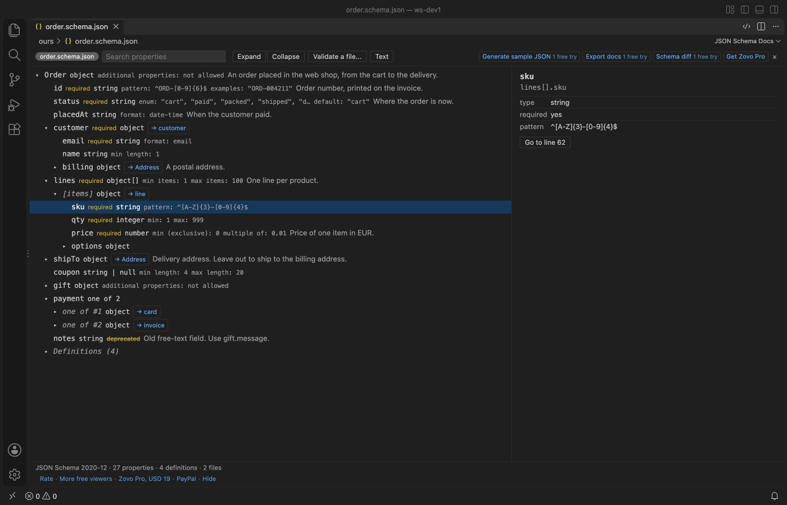

# JSON Schema Viewer & Validator

JSON Schema viewer and validator for VS Code, by Zovo. Open a JSON Schema as readable docs, a property tree with types, required marks and rules, and check JSON or YAML files against it with each error on its line.

Free, offline, no account. Zovo Pro: USD 19 once, for this and every other Zovo extension. It adds sample JSON and test data, docs export as Markdown or HTML, and a schema diff that lists breaking changes, with 1 free try of each. Everything free stays free.

*A real VS Code window running this extension on [`samples/shop/order.schema.json`](samples/shop/order.schema.json), the sample that ships with it.*

## Free

- Open a JSON Schema as docs: draft-04, draft-06, draft-07, 2019-09 and 2020-12, written in JSON or YAML. Right-click a `.schema.json`, `.schema.yaml` or `.schema.yml` file and pick "Open as JSON Schema Docs", or click the book button at the top right of a schema's text tab (it shows for those names and for any JSON or YAML file whose `$schema` is a json-schema.org address). Any other JSON or YAML file opens the same way from the Command Palette. The text editor stays the default.
- The property tree shows each property with its type, a "required" mark, a "deprecated" mark, the first rules (enum, const, default, format, pattern, min and max, lengths, item counts, multipleOf) and the first line of its description. Select a row to see every rule, the title, the full description and the `$comment` beside the tree.
- `$ref` opens in place: `#/$defs/...`, `#/definitions/...`, `$anchor`, `$id`, `$dynamicRef` and relative paths to other files on your computer, also through a web `$id` when the file sits next to the schema. A schema that refers to itself opens one level per click. `allOf`, `anyOf`, `oneOf`, `not`, `if`/`then`/`else`, `items`, `prefixItems`, `patternProperties` and `additionalProperties` show as rows of their own, and the definitions of the file are listed at the end.
- Remote `$ref` addresses (http, https) are never downloaded. They show with their address, and a click copies it.
- Search property names in the schema and the files it uses; click a result to open the tree at that row.
- Double-click a row (or press Enter) to open its line in the schema text beside the docs. "Go to the $ref target" opens the line the `$ref` points to, also in another file.
- The docs redraw while you type in the schema text, and when a file it uses changes.
- Validate any JSON or YAML file against a local schema: right-click it and pick "Validate Against a JSON Schema", or use the editor's right-click menu. The schema comes from the file's own `$schema` (a path next to it), from the `jsonSchemaViewer.schemas` setting, from your earlier pick for that file, or from a picker. Every error goes to the Problems panel with its data path, its line and the schema rule that failed.
- A file whose `$schema` is a json-schema.org address is checked as a schema against that draft's meta-schema, which ships inside the extension.
- From the docs view, "Validate a file..." checks a JSON or YAML file of the workspace against the open schema.
- A file you validated is checked again when you save it or one of its schema files.

## Quick start

1. Install JSON Schema Viewer & Validator.
2. Right-click a `.schema.json` file and pick "Open as JSON Schema Docs". No file at hand? Run "JSON Schema: Open the Sample Schema" from the Command Palette.
3. Click "Validate a file..." in the docs toolbar and pick a JSON or YAML file. Errors show in the Problems panel.

## Settings

- `jsonSchemaViewer.schemas`: schemas for files with no `$schema`, for example `[{ "fileMatch": ["config/*.yaml"], "url": "./schemas/config.schema.json" }]`. Paths are relative to the workspace folder. Web addresses are skipped.
- `jsonSchemaViewer.validateOnSave`: check validated files again on save (on by default).

## Zovo Pro tools (1 free try each)

- Generate sample JSON: one document with all fields, one with required fields only, or test data (an array of 1 to 1,000 documents with different values). Values follow enums, const, defaults, examples, formats such as email, date-time, uri and uuid, patterns, lengths and number limits. Every document is checked against the schema, and the status bar says how many pass.
- Export docs: the schema as one Markdown file or one HTML page with its styles inside and no scripts. A section per object (the root, each definition, each nested object) with a table of properties: type, required, description and rules. Each `$ref` links to the section of its target.
- Schema diff: compare the schema with an older version (any other schema file) and get a Markdown report. Breaking changes come first: removed properties, new required fields, narrowed types, removed enum values, tighter limits, new patterns, objects closed to other keys. Safe changes and title or description changes are listed apart.

## Limits

- Validation uses ajv 8. The "$schema" key at the top of a data file names its schema and is not checked against it.
- A remote `$ref` is taken as "anything goes" during validation, and the result says how many were not checked.
- Only the first document of a YAML file with several documents is read.
- Files up to 50 MB. The docs show up to 200,000 subschemas.

## Privacy

The extension makes no network requests and sends no telemetry. Your files stay on your computer.

## More from Zovo

- [JSON Editor, Tree & Form View](https://marketplace.visualstudio.com/items?itemName=zovo.zovo-json-editor): edit JSON files in a tree with a form beside it.
- [XSD Viewer & Schema Diagram](https://marketplace.visualstudio.com/items?itemName=zovo.zovo-xsd-viewer): XML Schema files as a tree and a diagram.

Made by Zovo. MIT license. Validation by ajv, ajv-formats and ajv-draft-04 (MIT), YAML by yaml (ISC), JSON with comments by jsonc-parser (MIT); see THIRD-PARTY-NOTICES.md.
